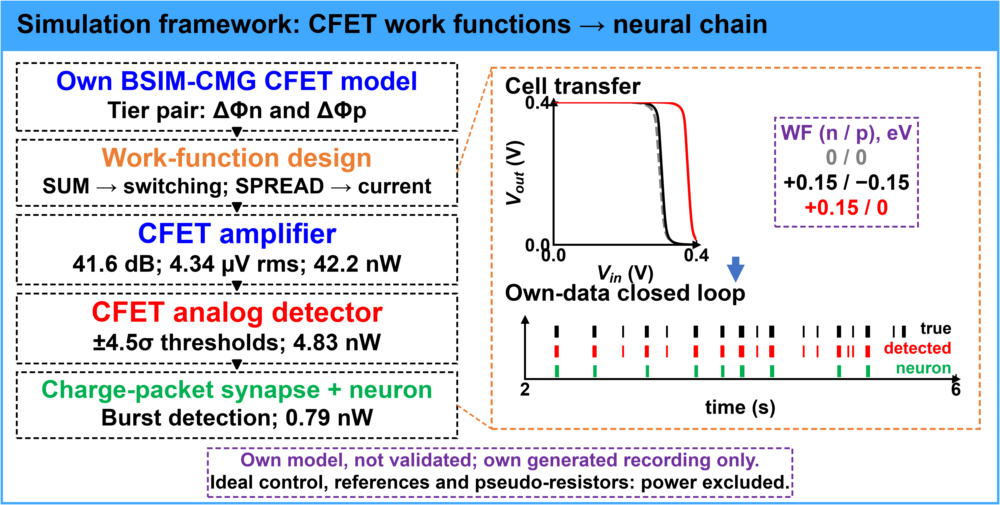
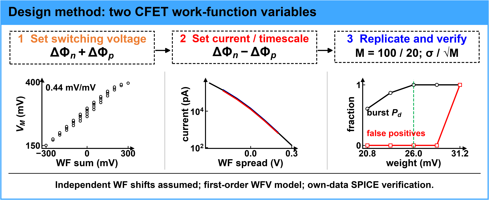
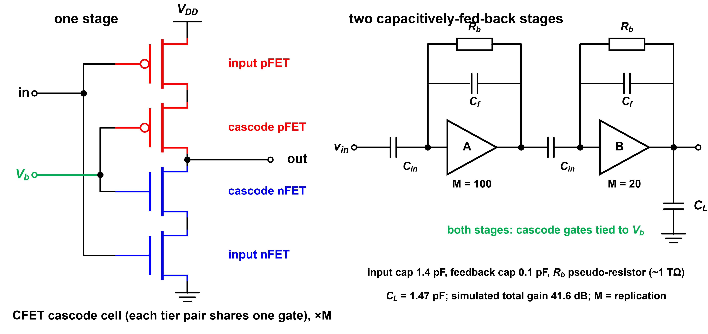
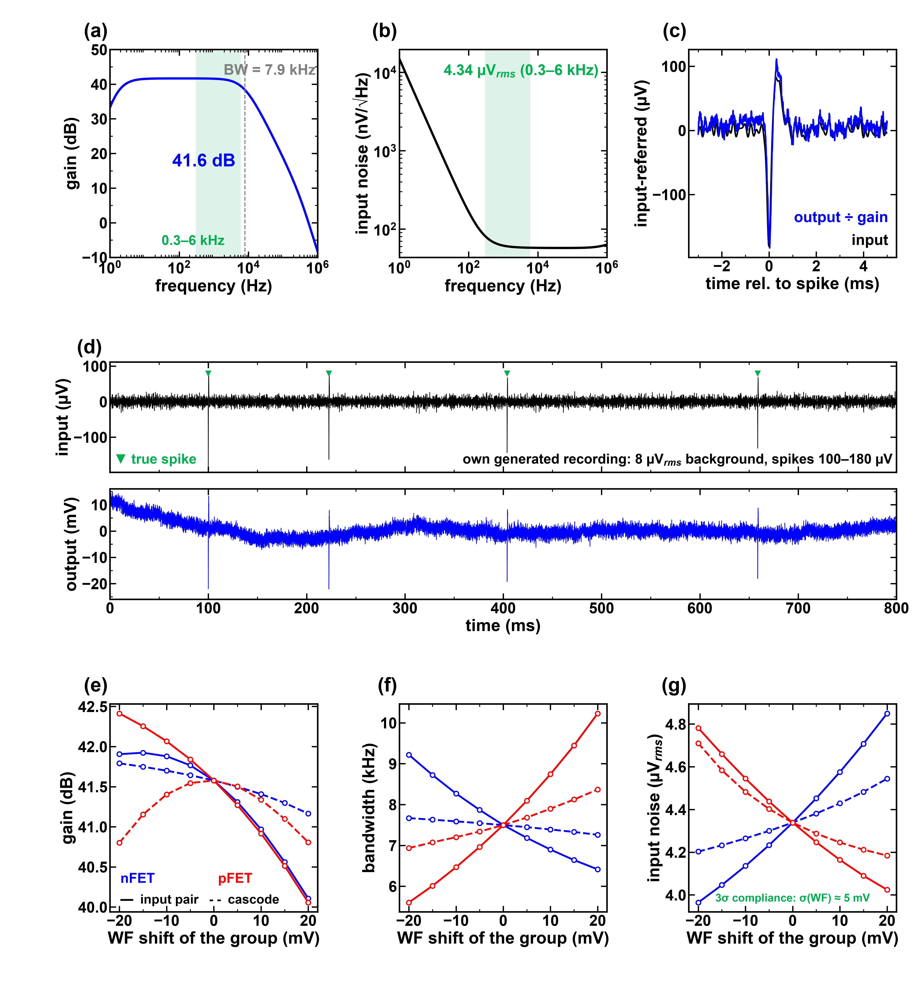
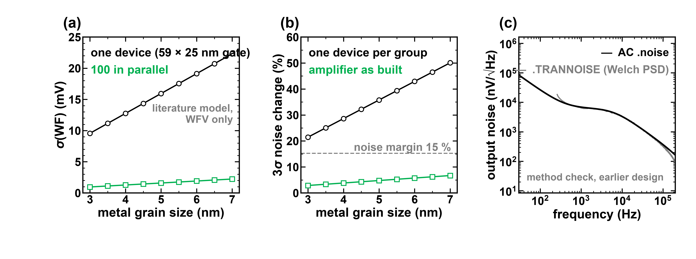
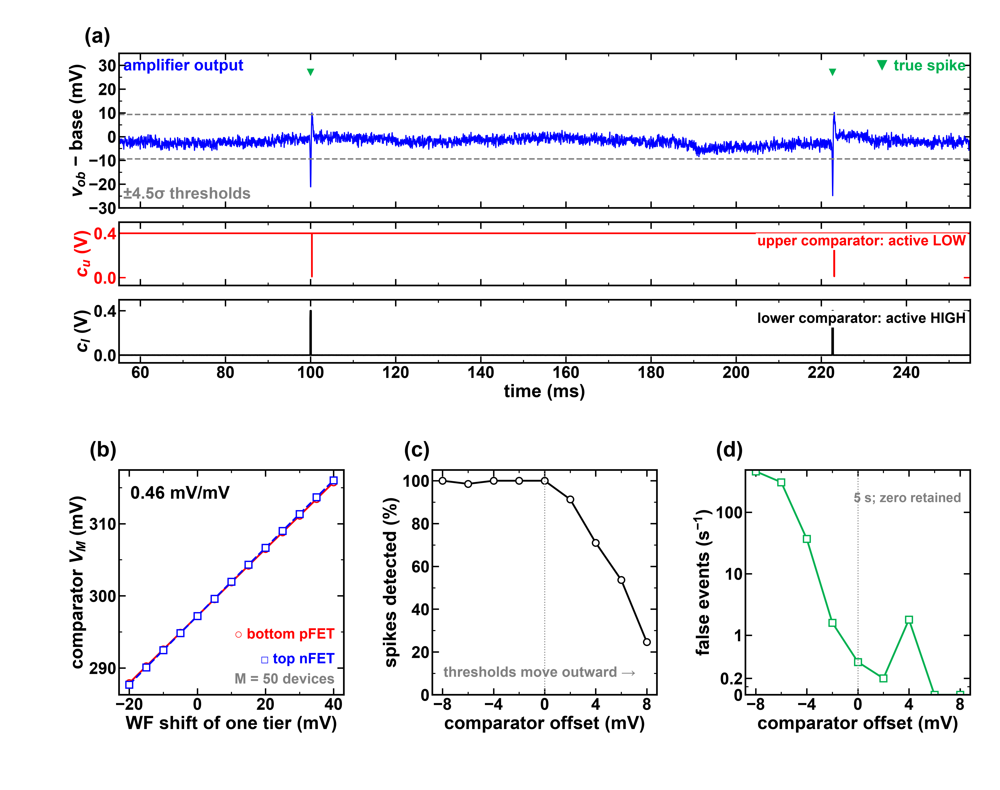
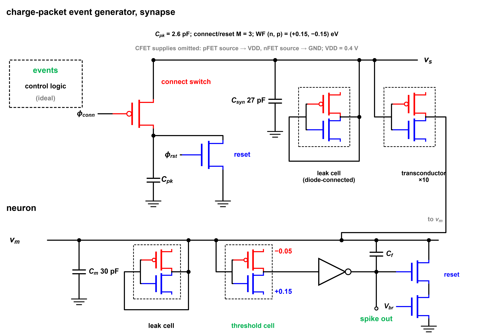
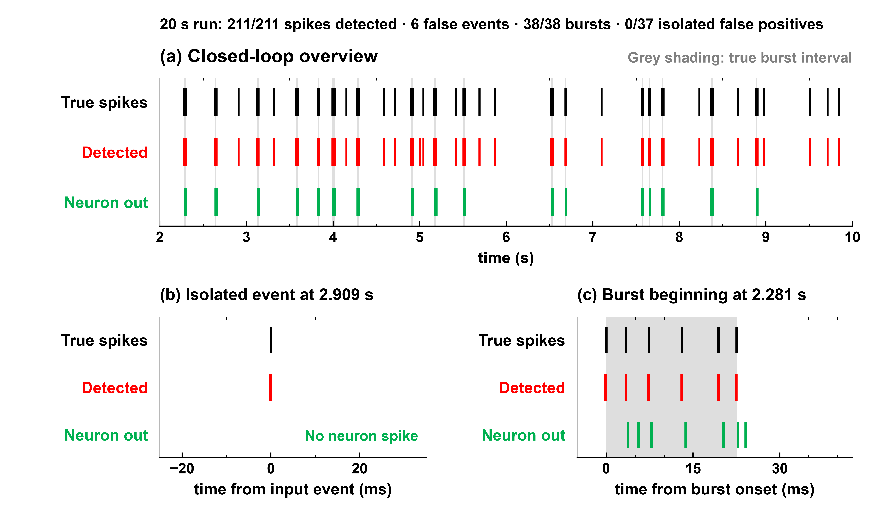
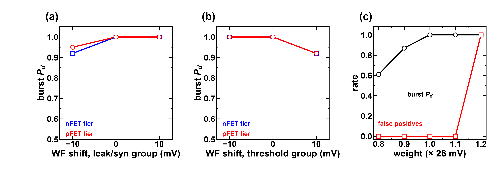

# Variability-Aware CFET Transconductance Amplifier for Analog Neural Signal Processing

**Authors:** Tushar Dudeja, Naushad Manzoor Laskar, Vellore Institute of Technology (VIT)
**Tools:** Synopsys PrimeSim HSPICE, BSIM-CMG compact model, Python

An all-CFET analog chain for neural recording: a low-noise amplifier, an analog spike
detector, a charge-packet synapse and a spiking neuron that detects bursts of neural
activity. Every block is built from one CFET cell type, and the circuit is simulated
with a BSIM-CMG CFET compact model.

> **Scope.** Everything here is simulation. The CFET model is a BSIM-CMG model that
> was first fitted to published CFET transfer curves and then modified for this
> application; it is not a validated replica of a fabricated device. All spike
> recordings used for the results are generated by this project, not external data.

---

## The idea: two work functions per cell as two design knobs

In a CFET the nFET sits directly above the pFET, and each tier can be given its own
gate work-function (WF) shift. In a diode-connected CFET cell these two shifts act
almost independently:

- their **sum** sets the cell's switching point, and
- their **spread** sets its conductance, and so its current and time constant.

So a single cell type, tuned only by its WF pair, can serve as the amplifier's gain
cell, a self-biased leak, a threshold and a synapse, without bias generators or
transistor sizing.

| WF shift (nFET, pFET), eV | Switching point | Small-signal conductance |
|---|---|---|
| (0, 0)           | 0.291 V | 762 nS |
| (+0.05, −0.05)   | 0.295 V | 201 nS |
| (+0.10, −0.10)   | 0.296 V | 44 nS |
| (+0.15, −0.15)   | 0.297 V | 8.96 nS |
| (+0.15, −0.05)   | 0.343 V | 41 nS |
| (+0.15, 0)       | 0.364 V | 81 nS |

*Diode-connected cell at V_DD = 0.4 V: equal-and-opposite shifts change conductance
by about 85× while the switching point moves only 6 mV.*





---

## Results

### Amplifier (0.4 V supply)

| Metric | Value |
|---|---|
| Mid-band gain | 41.6 dB |
| Bandwidth | 7.9 kHz |
| Input-referred noise (300 Hz–6 kHz) | 4.34 µV rms |
| OTA power | 42 nW nominal, 59 nW worst case |
| Corners (±10 mV WF, cascode WF, 37 °C) | all 8 pass, worst-case margin +7 % |

Transient device noise was checked against AC noise analysis: 0.437 mV rms both
ways (ratio 1.00 over 8 seeds), spectra within 8 %.




### Work-function variation

Using a published metal-grain model (Yang et al., IEEE TED 70(7), 2023) for this
59 nm × 25 nm gate, σ(WF) is 9.6–22.3 mV per device for grain sizes of 3–7 nm.
With the amplifier's parallel devices (M = 100 input, M = 20 cascode), first-order
propagation keeps gain, noise and bandwidth inside spec at 3σ for all three grain
sizes. A single unreplicated device would fail.



### Full chain: amplifier → analog detector → synapse → neuron

On a generated 20 s recording (211 spikes of 100–180 µV, 8 µV rms background):

| Stage | Result |
|---|---|
| Analog CFET detector | 211/211 spikes found, 6 false events |
| Burst detection (synapse + neuron) | **38/38 bursts detected, 0/37 isolated spikes misclassified** |
| Synapse + neuron power | 0.79 nW |
| Same as an ideal software neuron? | yes, on the same detected events |

With weaker spikes (40–80 µV), the software threshold detector still finds 201/211
and burst detection stays at 38/38 with no false alarms. The analog detector's own
amplitude limit is in Figure 11 of the figure index (0 % detection up to 40 µV,
100 % at 140 µV).





### Robustness of the neuron chain

| Change | Burst detection | False alarms |
|---|---|---|
| Nominal | 1.00 | 0 |
| WF ±10 mV on any leak/synapse/threshold tier (8 cases) | 0.92–1.00 | 0 |
| Event weight ×0.9 / ×1.1 | 0.87 / 1.00 | 0 |
| Temperature 10 / 37 / 60 °C | 1.00 / 0.97 / 0.82 | 0 / 0 / 0.03 |



---

## Device requirement found along the way

Gate leakage (IGC/IGB) costs the amplifier 3–4 dB of gain and adds 0.3 µV of noise,
while GIDL has no measurable effect. The amplifier therefore assumes a gate stack
with suppressed gate leakage; Figure 5 shows the comparison.

## Limitations

- Simulation of a fitted-then-modified compact model; no silicon.
- Control phases, OR/refractory logic, reference voltages, amplifier bias and
  pseudo-resistors are ideal; reported power excludes them.
- Variability uses one literature WF model with first-order propagation and assumes
  independent parallel devices; no Monte Carlo.
- One synthetic recording style.

## Repository contents

```
figures/   result and circuit figures (600 dpi PNG)
results/   chosen amplifier design and sensitivity/tolerance results (JSON)
docs/      FIGURE_INDEX.md: a caption and the conditions for every figure
```

The compact-model card and simulation decks are not included.

## License

All rights reserved. Shared for reference; contact the authors for reuse.
