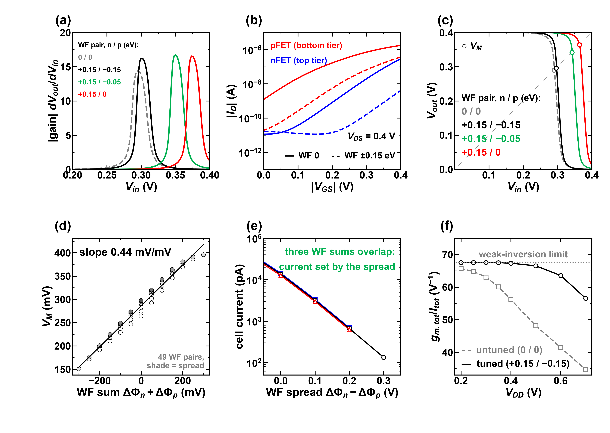
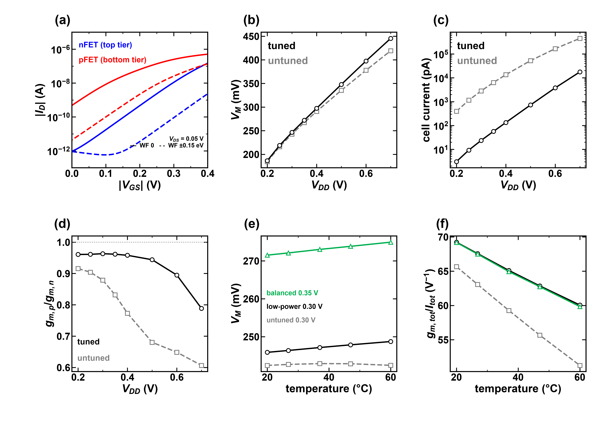
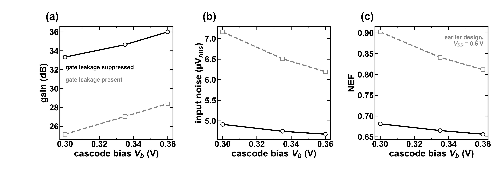
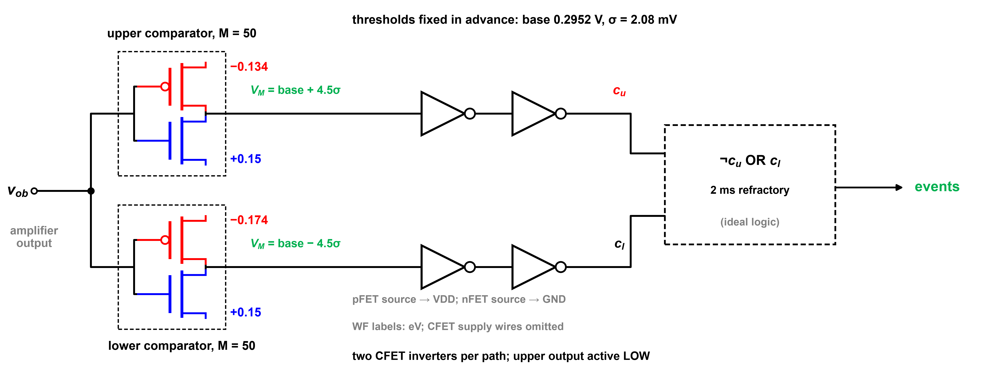
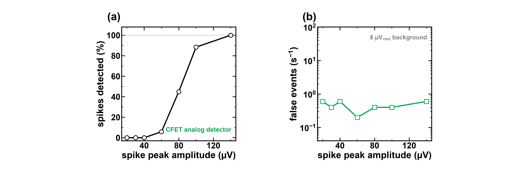
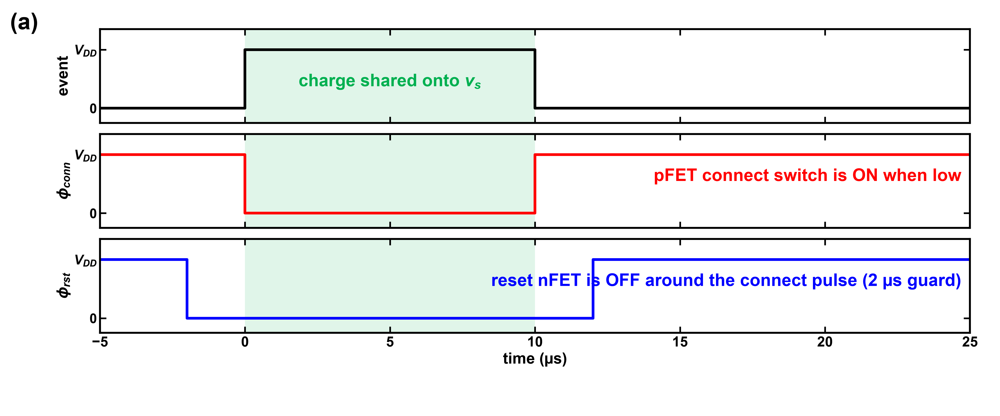
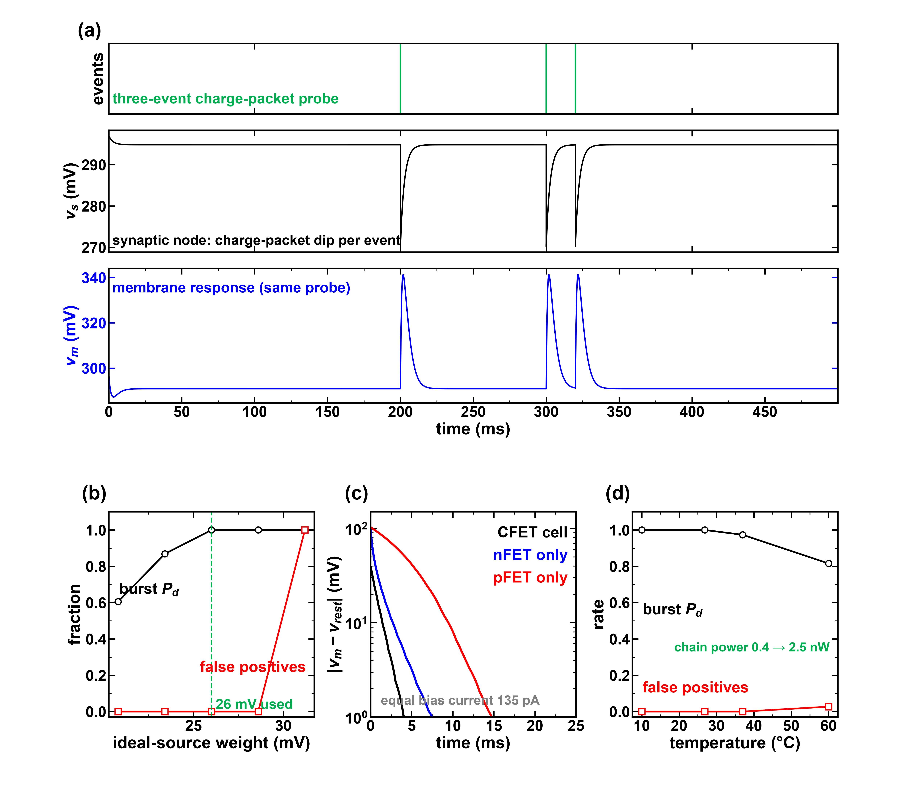
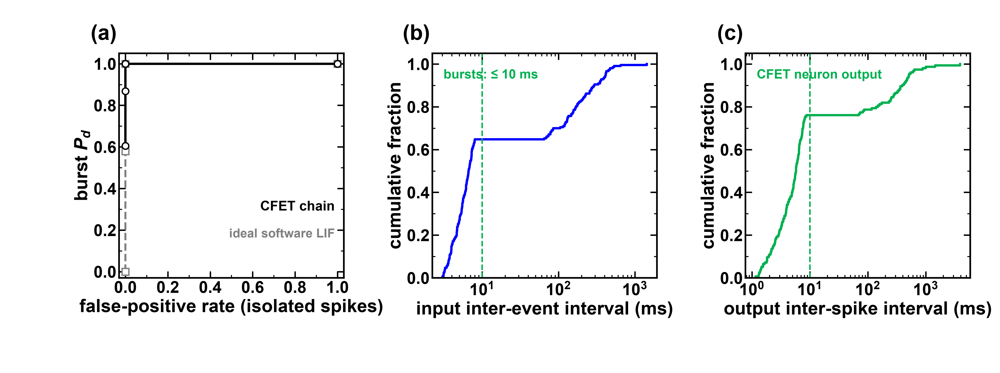

# Figure index

All plotted electrical results are simulations of our own BSIM-CMG-based CFET model, initially fitted to published curves and then modified; not a validated device replica. All spike recordings are generated by this project. Colours: blue nFET, red pFET, grey reference, green accent. WF shifts expressed as equivalent voltages in sweep axes; WF tuples use eV.

## Figures

### Figure 1. Simulation framework

Work-function design and the amplifier, analog detector, charge-packet synapse and neuron. Insets use saved VTCs and recovered closed-loop events. Own seed-22 recording: 20 s, 211 spikes. The power values exclude ideal control logic, references and pseudo-resistors.

### Figure 2. Work-function design method

WF sum primarily sets switching voltage; WF spread primarily sets current in the sampled designs. Replication reduces independent work-function variation by the square root of M. The result inset uses the existing seed-22, 20 s ideal-source weight sweep (20.8-31.2 mV); lines guide the eye.

### Figure 3. CFET cell characteristics

Simulated gain, tier I-V curves, transfer curves, switching voltage versus WF sum, current versus WF spread and transconductance efficiency versus supply. WF tuples are ordered (nFET, pFET). No new device calibration or experimental validation is claimed.

### Figure 4. Cell supply and temperature response

Low-drain-bias I-V and supply/temperature sweeps from the saved cell simulations. Temperature panels distinguish the earlier 0.30 V low-power and 0.35 V balanced cell designs; they do not describe the chosen 0.40 V amplifier.

### Figure 5. Gate-leakage requirement

Earlier amplifier design, VDD = 0.5 V: gain, input noise and NEF with gate leakage enabled versus suppressed. These are model-based mechanism comparisons, not measured gate-stack performance. Noise integrated over 300 Hz-6 kHz.

### Figure 6. Two-stage amplifier circuit

CFET cascode cell and two capacitively fed back stages. M = 100 and M = 20 denote parallel device replication, not voltage gain. Cin = 1.4 pF, Cf = 0.1 pF, CL = 1.47 pF; VDD = 0.4 V, Vb = 0.230 V. Ideal pseudo-resistors and bias source; added model parasitics are omitted from the drawing.

### Figure 7. Chosen amplifier response and sensitivity

Chosen 0.40 V amplifier: nominal 41.58 dB, 7.94 kHz, 4.338 uV rms over 300 Hz-6 kHz and 42.16 nW OTA power. Saved own-data transient and deterministic WF-group sweeps. Interpolated bandwidth may differ slightly from the coarse AC-grid result. The common sigma tolerance is a first-order 3-sigma compliance estimate, not a deterministic shift band.

### Figure 8. Work-function variation and noise-method check

Literature grain-model estimate for this 59 x 25 nm gate; WFV only. First-order propagation assumes independent parallel devices (M = 100 input, M = 20 cascode), no Monte Carlo. Panel (c) compares AC noise and transient-noise PSD for an EARLIER 0.6 V amplifier; it does not validate the compact model. Source: Yang et al., IEEE TED 70(7), 2023, local ECNU CFET variation paper.

### Figure 9. Analog detector circuit

Two M = 50 CFET comparators and two restoring inverters per path. WF labels are in eV, with nFET values blue and pFET values red. Upper output is active low; event logic uses NOT(cu) OR cl with ideal 2 ms refractory control. Thresholds are fixed from the 2 s output probe; supply wires are omitted explicitly.

### Figure 10. Comparator waveforms and offset sensitivity

Recovered figb_off runs: amplifier output relative to its baseline in mV, comparator outputs on separate physical voltage axes, switching-voltage response and detection/false-event curves. Each offset uses the same first 5 s segment (69 true spikes). Positive offset moves both thresholds outward. The false-event axis is symmetric-log near zero; zero counts are preserved.

### Figure 11. Analog detector amplitude limit

Saved own-data amplitude sweep: one 5 s segment per amplitude, 69 true spikes, 8 uV rms background, fixed thresholds. Detection is 0% through 40 uV, 6% at 60 uV, 45% at 80 uV, 88% at 100 uV and 100% at 140 uV. Lines guide the eye; this is not an amplitude-general performance guarantee.

### Figure 12. Charge-packet synapse and neuron circuit

Netlist-matched pFET connect switch, nFET reset, capacitor-ratio event input, CFET synaptic leak/transconductor and neuron. Exactly one restoring inverter follows the threshold cell. Cpk = 2.6 pF, Csyn = 27 pF, Cm = 30 pF, feedback Cf = 1.5 pF, reset M = 30 and Vbr = VDD = 0.4 V. Supply wires and ideal control generation are explicitly omitted.

### Figure 13. Charge-packet control phases

Specified ideal input phases: 10 us pFET connect pulse, active low; reset nFET off from 2 us before connection until 2 us after disconnection. Timing is the commanded stimulus, not a simulated digital-controller implementation.

### Figure 14. Charge sharing and neuron robustness

Panel (a): recovered separate three-event probe at 200, 300 and 320 ms, showing synaptic and membrane voltages; no output trace was recorded for this probe. Panel (b): five existing ideal-source weight settings, own seed-22 20 s train. Panel (c): saved single-tier decay comparison at equal 135 pA bias, Cm = 10 pF; single-tier devices use ideal bias sources. Panel (d): existing 10, 26.85, 37 and 60 C runs. Curves connect sampled cases.

### Figure 15. Deterministic chain tolerance

Own seed-22 20 s events, weight 26 mV. Individual leak/synapse and threshold-tier shifts of +/-10 mV, plus +/-10% and +/-20% event-weight settings. The isolated-spike false-positive fraction becomes 1 at +20% weight. These are deterministic tests, not statistical yield estimates.

### Figure 16. Burst trade-off and event interval distributions

Panel (a): sampled ideal-source CFET weight sweep versus a software LIF weight sweep, using the same seed-22 events and burst/isolated labels restricted to 20 s. Panels (b,c): empirical cumulative interval distributions, not bar charts; output events come from the analog-detector/charge-packet closed loop. A 10 ms guide marks the task interval criterion.

### Figure 17. Closed-loop event raster

Recovered true events, analog-detected events and charge-packet neuron output; panel (a) shows 2-10 s of the 20 s run; panels (b,c) show the first eligible isolated event and burst in that interval, with time relative to the event/onset. Full-run totals: 211/211 spikes detected, 6 false events, 156 neuron spikes; all 38 clear bursts detected and 0/37 isolated spikes falsely classified. Grey shading marks task burst intervals. Own generated recording only.
